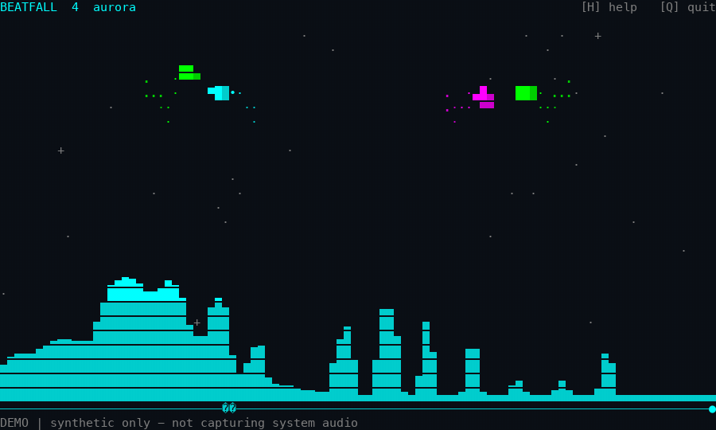

# cava-with-ball



A Linux terminal audio spectrum with one to eight bouncing, shaded balls (three
by default). Arcade motion keeps them bouncing and exploring even in quiet
passages; bass onsets and nearby frequency bands add lift. Collision sparks,
launch rings, a twinkling starfield, optional trails, and four palettes accompany
the motion. Rendering targets 60 FPS; physics runs independently at 240 Hz.

## Install and try it

From a source checkout (stable Rust **1.85+**):

```sh
cargo build --release --locked
./target/release/cava-with-ball --demo --trails

# Or install into ~/.cargo/bin:
cargo install --path . --locked
cava-with-ball --demo --balls 3 --palette ocean --trails
```

No native audio development libraries are needed to build. Use a UTF-8 terminal
with single-cell Unicode block glyphs; 80×24 or larger is recommended. Below
24×10 the app shows a resize prompt and keeps accepting input.

Published GitHub releases include Linux x86-64 and ARM64 musl archives with the
executable, this README, the changelog, and the MIT license:

```sh
sha256sum --check cava-with-ball-0.1.0-x86_64-unknown-linux-musl.tar.gz.sha256
tar -xzf cava-with-ball-0.1.0-x86_64-unknown-linux-musl.tar.gz
install -Dm755 cava-with-ball-0.1.0-x86_64-unknown-linux-musl/cava-with-ball \
  "$HOME/.local/bin/cava-with-ball"
```

Use the `aarch64-unknown-linux-musl` archive on ARM64 and substitute the release
version. Ensure the install directory is on your `PATH`. Checksums verify the
downloaded bytes; they are not cryptographic signatures.

## Linux desktop audio

The reliable capture path is **PulseAudio**, or **PipeWire with its PulseAudio
compatibility server** (`pipewire-pulse`). Install `pactl` and `parec`; source
discovery requires JSON output (PulseAudio 15+).

```sh
sudo apt install pulseaudio-utils     # Debian / Ubuntu, including PipeWire
sudo pacman -S libpulse               # Arch Linux
sudo dnf install pulseaudio-utils     # Fedora

pactl info                            # Confirm your user's server is reachable
cava-with-ball --list-sources
cava-with-ball                        # Capture the default sink's monitor
cava-with-ball --source 42            # Or a source ID from --list-sources
cava-with-ball --source alsa_output.pci-0000_00_1f.3.analog-stereo.monitor
cava-with-ball --microphone           # Default input, never a playback monitor
```

- A **playback monitor** captures audio sent to an output device, not your room.
  Start music in another application to drive the visualization.
- An **input** is a microphone or line input. Explicit `--source` selects either
  kind; `--microphone --source NAME` requires an input. Default playback
  selection never falls back to a microphone.
- Run as your normal desktop user, **not with `sudo`**.
- If the bars stay flat, check the selected sink/monitor, stream routing, mute
  state, and permissions in `pavucontrol`. A `DEMO` footer means real audio is
  not selected.
- Selection happens at startup; restart after a default-device change or
  reconnect. Startup failures explain missing tools/server/source. Later capture
  errors appear in the footer without blocking input. There is no automatic
  reconnection.

## Raw PCM input

`--stdin` accepts **headerless little-endian f32le mono** samples (nominally in
`[-1, 1]`) at `--sample-rate` Hz (default **48000**). Non-finite values become
zero; out-of-range values are clipped. The producer must supply the declared
rate in real time. There is no resampling, channel conversion, or format
detection: convert WAV, compressed audio, s16 PCM, and stereo before piping.

```sh
# Visualize a file in real time; this does not play it through speakers:
ffmpeg -nostdin -re -i music.flac -vn -f f32le -ac 1 -ar 48000 - \
  | cava-with-ball --stdin --sample-rate 48000 --trails

# Explicit Linux monitor pipeline; replace the device with an actual source:
parec --device=YOUR_SINK.monitor --raw --format=float32le \
  --channels=1 --rate=48000 --latency-msec=30 \
  | cava-with-ball --stdin --sample-rate 48000
```

Stdout must remain a terminal; keyboard input is read from `/dev/tty`
separately from PCM. A producer that writes an entire file immediately is
drained immediately, not replayed. On EOF the bars decay and the UI stays open
until you quit. Incomplete trailing samples are reported. Pausing never stops
the audio drain.

## Controls

| Key | Action |
| --- | --- |
| Q / Esc / Ctrl-C | Quit and restore the terminal |
| A / D or ← / → | Override automatic cruising; remember the steered direction |
| Space | Headroom-limited upward launch with a fading ring |
| + / = | Add a ball (up to 8) |
| - | Remove a ball (minimum 1) |
| P | Pause/resume animation; audio keeps draining |
| T | Cycle aurora, ember, ocean, and mono palettes |
| S | Toggle collision sparks |
| B | Toggle the starfield |
| L | Toggle trails (off by default; `--trails` enables at startup) |
| H | Toggle compact help |
| R | Reset balls, keeping their count |

Letter controls are case-insensitive. Legacy terminals rarely send key releases,
so steering uses short pulses renewed by key repeat. While paused, settings,
count changes, and reset still work; motion and launch effects remain frozen.

## Configuration

```sh
cava-with-ball --demo --balls 4 --fps 60 --sensitivity 1.4 \
  --gravity 32 --palette ember --color truecolor --trails
```

`--help` documents every option. Ranges: balls 1–8, FPS 15–120, sensitivity
0.05–20, gravity 5–150 (cell widths/s²), sample rate 8000–192000 Hz. Invalid or
conflicting values are rejected before raw mode.

`--color auto` chooses RGB when `COLORTERM` is `truecolor`/`24bit` or `TERM`
ends in `-direct`; otherwise it uses the terminal's 16-color theme. `NO_COLOR`
selects ANSI16 in auto mode, not color-free output. Explicit `--color
truecolor`/`ansi` overrides detection. The `mono` palette is independent of this
choice.

## Architecture

| Module | Responsibility |
| --- | --- |
| `audio.rs` | Bounded sample ring, render-side snapshot, capture lifecycle, synthetic demo |
| `capture.rs` | Linux discovery/classification, `parec` ownership, cancellable PCM reads, EOF/error reporting |
| `spectrum.rs` | DC removal, 4096-sample Hann window, `rustfft`, 64 log bands, normalization, smoothing, bass-onset detection |
| `physics.rs` | 240 Hz steps, exact circle/spectrum contact, gravity-aware bounces, cruising, escape hops, personalities, bounded effects |
| `render.rs` | Fractional-block bars, personality-shaded balls/trails/rings, effects, help, differential output, terminal restoration |
| `input.rs`, `cli.rs` | Keyboard actions, steering state, validated options |
| `main.rs` | Frame deadlines, audio/analysis integration, fixed-step accumulator, pause and resize |

Bands span 35 Hz to `min(16000, 0.48 × sample_rate)` Hz. Hann-corrected
magnitudes map -65..0 dB to height; attack is 35 ms, decay 240 ms. Beats use
adaptive low-frequency energy with a 240 ms cooldown. Physics uses a 2:1 cell
aspect ratio and one circle-footprint contact for placement, normal, and bar
velocity, including narrow peaks and rising-bar embedding. Launches respect
headroom and substep speed bounds. Rendering writes only changed cells.

## Limitations

- **Linux is the release target.** Capture is PulseAudio/PipeWire-Pulse only;
  no direct ALSA or native PipeWire backend.
- macOS runs demo and PCM stdin for development; native Mac capture is not
  implemented. Windows is unsupported. No desktop GUI.
- Hardware routing, microphone permissions, and monitor availability belong to
  the audio server/desktop. Startup `pactl` calls use the client's own
  connection behavior, not an application-enforced deadline.

## License

[MIT](LICENSE)
